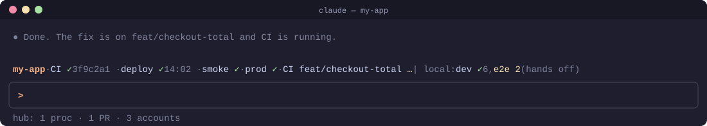
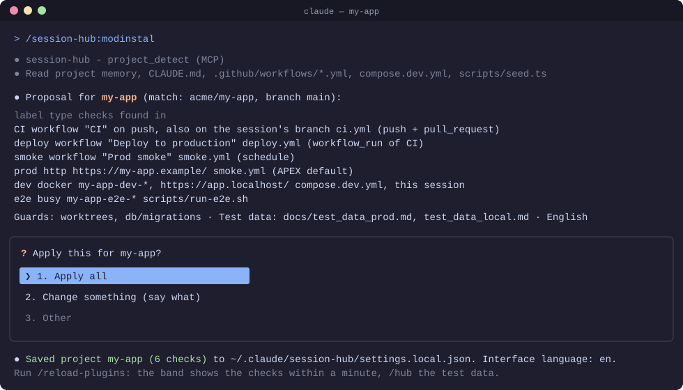
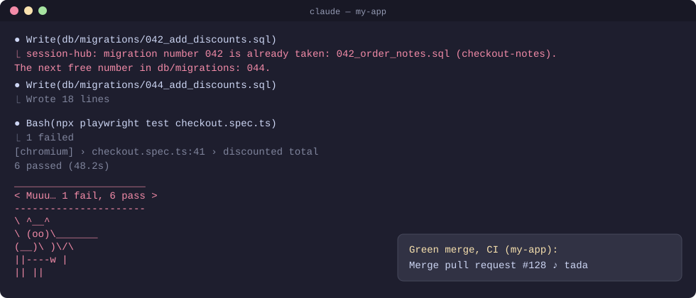
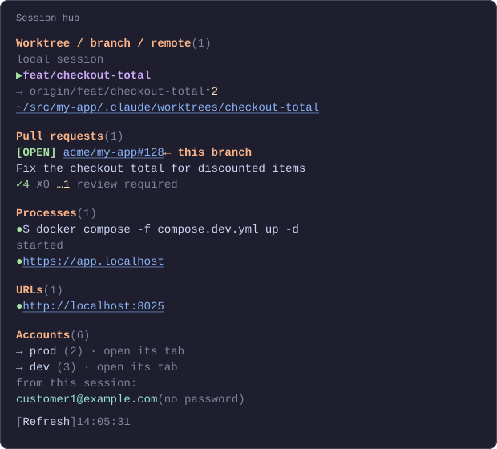
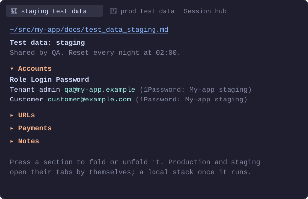

# session-hub

A Claude Code mod that keeps the state of your work in view while Claude works:

- **a band above the prompt** with your project's checks: CI, deploy, smoke tests, production, local docker stacks, containers to keep your hands off, any quick command;
- **notifications** (toast + sound) when CI turns red, a merge goes green, a deploy starts or ends, production stops answering;
- **guards** that stop Claude from committing in the main checkout or taking a migration number another branch already took;
- **a pane** (`/hub`) with what *this session* did: its worktree, branch and remote, PRs, processes and their URLs, test accounts, artifacts;
- **a cow** under every red test run and every commit.

Claude sets it up for each project: `/session-hub:setup` reads the repository and proposes the checks, and you confirm.



<sub>Illustrations of the terminal; colors follow your terminal theme.</sub>

## Install

In a Claude Code terminal session:

```
/plugin install session-hub --marketplace kofinet/session-hub
```

Answer `y` to add the marketplace and pick the **user** scope, so it loads in every session. The pane (`/hub`) and the cow work right away.

Then, in each project you want the band for:

```
/session-hub:modinstal
```

It configures everything for the project in one go: checks out that the mod is loaded, reads the project's memory, `CLAUDE.md`, docs and code, proposes the band's checks, the guards and the test data documents (`docs/test_data_<environment>.md`), asks for the interface language (English or Polish), saves what you confirm and asks you to reload the plugin. `/session-hub:setup` does only the band's checks and guards, e.g. to change them later.



Claude reads the facts of the repository (GitHub Actions workflows and their recent runs, running docker containers, compose files, folders of numbered migrations, worktrees) and what this session did, works out the checks and the guards, and shows them to you. Nothing is saved until you confirm. The settings go to `~/.claude/session-hub/settings.local.json`, **outside every repository**: production URLs and container names stay on your machine. Run `/session-hub:setup` again to change them.

<details>
<summary>Other ways to install</summary>

From a shell: `claude plugin install session-hub --marketplace kofinet/session-hub`.

In the desktop app, where `/plugin` does not run: click + next to the prompt box, then Plugins, Add marketplace with `kofinet/session-hub`, then Add plugin.

From a local clone (read straight from the folder; after an edit run `/reload-plugins`):

```
claude plugin marketplace add <path to the clone>
claude plugin install session-hub@session-hub --scope user
```

</details>

Needs `git`. The project checks use `gh` (signed in) for workflows, `docker` for containers and `curl` for local URLs, when the settings name such checks.

## The band and its checks

One row above the prompt, in the order of the settings: `name · label mark detail · … | local: label mark detail, …`, the local instances (`docker`, `busy`) set apart after the bar. ✓ fine, ✗ failing, … running, – off, ? unknown. It refreshes every 60 s and after each of Claude's turns.

| Type | Checks | Shows |
| --- | --- | --- |
| `workflow` | the newest run of a GitHub Actions workflow on the main branch (`gh run list`), optionally also on the session's own branch | state, commit (a deploy: its start time) |
| `http` | a GET of each URL (production, staging, a health endpoint); `accounts` names the repository's document of the environment's test accounts (`docs/test_data_prod.md`) | ✓ when all answer 2xx/3xx |
| `docker` | running containers whose names start with the given prefixes, and the stack's URL with `curl -k`; `accounts` names the repository's document of the stack's logins | ✓/✗, the number of running containers, `off` |
| `busy` | containers nobody should touch (e2e lanes, another session's stack) | `e2e 2 (hands off)` while any run |
| `command` | any quick command, every `everySeconds` (≥ 60, default 300) in the background | ✓ on exit 0 |

A `workflow` check has a `role`, which picks its notifications:

| Role | Toast and sound |
| --- | --- |
| `ci` | red: failure sound; turning green on the main branch: "green merge" (tada) |
| `deploy` | a new run: "a merge started a deploy"; its end: ✓ or failure sound |
| `check` | red: failure sound |

`http` and `command` checks announce turning red (failure sound) and back; `docker` checks announce containers that start restarting or turn unhealthy. Sounds use the platform's own player (Windows `Media.SoundPlayer`, macOS `afplay`; on Linux only the files you configure, with `paplay`).

## Guards



- `mainCheckout`: Write/Edit/NotebookEdit into the main checkout, and `git commit|checkout|switch|merge|rebase|reset|cherry-pick|revert|am|stash|restore` there (following `cd` and `git -C`), are refused with a reason Claude reads: work in a worktree.
- `migrationDirs`: a new `NNN_name.*` file in one of those folders is refused when another file already carries that number in any worktree of the repository or on `origin/<branch>`; the refusal names the clash and the next free number.

## The pane: `/hub`



What **the current session** did, every item clickable; nothing from other sessions, nothing the session merely read.

- **Worktree / branch / remote**: whether the session runs locally or remotely (Claude Code on the web); the session's worktree (▶) and the ones it created or entered, each with its upstream (`→ origin/x`, `↑ahead ↓behind`, or not pushed yet).
- **Pull requests**: the PR of the session's branch and the PRs it created or changed, with checks and review state.
- **Processes**: what the session started (background tasks, servers, containers, start scripts) with their URLs; ● green when the port is listening.
- **URLs**: local addresses the session gave that belong to none of its processes.
- **Accounts**: first, for each `http` check and each running `docker` check with an `accounts` document, a folded group `▸ prod (4)`; press it to see the whole document (test accounts, cards, bank accounts…; headings bold, tables aligned, the first 200 lines) and a link to it; the number counts the logins it lists (read again on every refresh, from the checkout the session works in, its worktree too); a login two documents both list counts once; `▸ staging (no document)` when the document cannot be read. Then the logins the session gave that no such document lists (`user / password`, tables, e-mail logins, addresses on test domains); `user1..3@example.com` is listed as three accounts, each with what the session said about it. No accounts at all, no section.
- **Artifacts**: claude.ai artifacts and docs, documents it wrote, design links.

It opens by itself the first time it finds something (from 144 terminal columns up); `r` refreshes it. The status line shows `hub: 2 proc · 1 PR · 3 accounts`.



## The cow

Under a red test run (`npm test`, `playwright test`, `dotnet test`, `vitest`, `bun test`, `claude plugin test`) with its counts, and under every `git commit` with the new commit. `"cow": false` in the settings turns it off.

## Configuration

### Where it lives

One file for all your projects, **outside every repository**: `~/.claude/session-hub/settings.local.json` (Windows: `%USERPROFILE%\.claude\session-hub\settings.local.json`), or the path in the `SESSION_HUB_SETTINGS` environment variable. Production URLs, container names and labels stay on your machine.

`/session-hub:modinstal` and `/session-hub:setup` write it for you and change only the current project's entry. You can also edit it by hand; the band reads it again on its next refresh (within 60 s). After installing or updating the plugin, run `/reload-plugins` (or start a new session).

The full shape, with every kind of check, is in [`settings.example.json`](settings.example.json):

```json
{
  "version": 1,
  "language": "en",
  "cow": true,
  "sounds": {},
  "projects": [
    {
      "name": "my-app",
      "match": { "remote": "acme/my-app" },
      "branch": "main",
      "checks": [
        { "type": "workflow", "label": "CI", "workflow": "CI", "role": "ci", "event": "push", "onSessionBranch": true },
        { "type": "workflow", "label": "deploy", "workflow": "Deploy to production", "role": "deploy" },
        { "type": "http", "label": "prod", "urls": ["https://my-app.example/"], "accounts": "docs/test_data_prod.md" },
        { "type": "http", "label": "staging", "urls": ["https://staging.my-app.example/"], "accounts": "docs/test_data_staging.md" },
        { "type": "docker", "label": "dev", "containerPrefixes": ["my-app-dev-"], "url": "https://app.localhost/", "accounts": "docs/test_data_local.md" },
        { "type": "busy", "label": "e2e", "containerPrefixes": ["my-app-e2e-"] },
        { "type": "command", "label": "types", "command": ["npx", "tsc", "--noEmit"], "everySeconds": 600 }
      ],
      "guards": { "mainCheckout": true, "migrationDirs": ["db/migrations"] }
    }
  ]
}
```

### Top level

| Field | Meaning |
| --- | --- |
| `language` | the interface's language: `en` (default) or `pl`; the pane, the band, the status line, notifications and the guards' messages |
| `cow` | the cow (default `true`) |
| `sounds` | `false` for none, or `{ "merge" \| "deploy" \| "failure": "<file>" }` replacing the platform's defaults |
| `projects[]` | one entry per project |

### A project

| Field | Meaning |
| --- | --- |
| `name` | shown in the band and the notifications |
| `match` | how a session's repository is recognised: `remote`, part of the `origin` URL (`acme/my-app`, any URL form), or `path`, the main checkout's folder |
| `branch` | the main branch (default `main`) |
| `checks[]` | the band's checks, shown in this order (below) |
| `guards` | `mainCheckout` (default `false`): refuse edits and committing git commands in the main checkout; `migrationDirs`: folders of numbered migrations, paths from the repository root |

### Checks

Every check has a `type` and a short `label` (what the band shows).

| Type | Fields |
| --- | --- |
| `workflow` | `workflow`: the GitHub Actions workflow's name · `role`: `ci`, `deploy` or `check` (default) · `event`: only runs of that event (`push`) · `onSessionBranch`: also show the run on the session's own branch (default `false`) |
| `http` | `urls`: public addresses that must answer 2xx/3xx · `accounts` (optional): the environment's test data document |
| `docker` | `containerPrefixes`: name prefixes of the stack's containers · `url` (optional): the stack's local address, checked with `curl -k` · `accounts` (optional): the stack's test data document |
| `busy` | `containerPrefixes`: containers nobody should touch while they run |
| `command` | `command`: an argument list, run without a shell from the main checkout · `everySeconds`: how often (≥ 60, default 300) |

### Test data documents

`accounts` names a Markdown file **in the repository**, relative to its root (an absolute path works too), one per environment:

```
docs/test_data_prod.md
docs/test_data_staging.md
docs/test_data_local.md
```

The pane shows each under its check's label in the **Accounts** section (production and staging always, a `docker` stack while it runs); pressing it shows the whole document: test accounts, test cards, bank accounts, how to sign in. It is read from the checkout the session works in, so a branch's own changes to it show. A table like this one gives the count next to the label:

```markdown
| Role | Login | Password | Where |
|---|---|---|---|
| Tenant admin | admin@shop.example | (1Password: Shop prod) | /admin |
| Customer | klient@example.com | (1Password: Shop prod) | shop |
```

For production and staging the Password column says **where the password is kept**, never the password: the document is committed. Local stacks may list their obviously fake seeded logins (`admin / admin123`).

An entry that cannot be read is left out and named in a toast.

### Language

The interface speaks English or Polish: `"language": "en"` (the default) or `"pl"` at the top of the settings. `/session-hub:modinstal` asks for it; change it there, or by hand and `/reload-plugins`.

## Development

```
claude plugin validate .
claude plugin test .
```

## License

MIT, see [LICENSE](LICENSE).
